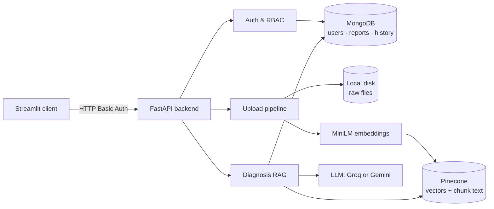

# Medical Report Diagnosis — RAG with Role-Based Access

An AI system that reads a patient's medical report (PDF or TXT) and generates a **cited, report-grounded diagnosis** using Retrieval-Augmented Generation (RAG). Patients upload reports and ask questions; doctors review their patients' diagnosis history; admins manage accounts.

> ⚠️ **Disclaimer:** This is an educational project. Its output is AI-generated information, **not medical advice**, and must be reviewed by a qualified clinician.

---

## Features

- **RAG pipeline** — reports are chunked, embedded (MiniLM) and stored in Pinecone; answers are generated only from the retrieved report text.
- **Per-report retrieval** — the vector search is filtered by document ID inside Pinecone, so a patient's question only ever retrieves their own report.
- **Page-level citations** — every answer lists its sources, e.g. `report.pdf (page 2)`.
- **Multi-file upload** — upload several PDF/TXT files at once; all are indexed under one document ID.
- **Role-based access control (RBAC)**
  - **Patient** — upload reports, request diagnoses (own reports only)
  - **Doctor** — view patients' diagnosis history
  - **Admin** — create doctor/patient/admin accounts, list users
- **Secure signup** — public signup always creates a *patient*; doctors are created only by an admin.
- **Switchable LLM** — Groq (default `openai/gpt-oss-120b`) or Google Gemini via one `.env` setting; each answer records which model produced it.
- **Audit-friendly history** — every diagnosis is stored with question, answer, sources, model and timestamp.

---

## Architecture



### How it works

**1. Upload (indexing)**
```
PDF/TXT → save to disk → load pages → split into ~1000-char chunks (100 overlap)
        → MiniLM embedding (384-dim) → Pinecone upsert
          (vector + metadata: doc_id, uploader, source, page, original chunk text)
        → report record in MongoDB (doc_id, filenames, uploader, num_chunks)
```

**2. Diagnosis (retrieval + generation)**
```
question → MiniLM embedding → Pinecone query (top-5, filter doc_id = this report)
         → read the original chunk TEXT from metadata (vectors are never decoded)
         → prompt = instructions + labelled context + question → LLM
         → diagnosis + key findings + suggested next steps, with citations
         → saved to diagnosis history
```

The embedding model is only used for **similarity search**. The LLM receives the **original text** stored alongside each vector, never the vectors themselves.

---

## Tech Stack

| Layer | Technology |
|---|---|
| Backend API | FastAPI, Uvicorn |
| Frontend | Streamlit |
| RAG / orchestration | LangChain (loaders, text splitter, prompt chaining) |
| Embeddings | `sentence-transformers` — `all-MiniLM-L6-v2` (384-dim) |
| Vector database | Pinecone (serverless) |
| LLM | Groq (`openai/gpt-oss-120b`) or Google Gemini (`gemini-2.5-flash`) |
| Database | MongoDB (users, reports, diagnosis history) |
| Auth | HTTP Basic + bcrypt password hashing, role-based access |

---

## API Endpoints

| Method | Endpoint | Role | Description |
|---|---|---|---|
| `POST` | `/auth/signup` | Public | Create a **patient** account |
| `GET` | `/auth/login` | Any user | Verify credentials, return role |
| `POST` | `/auth/users` | Admin | Create a user with a role (e.g. doctor) |
| `GET` | `/auth/users` | Admin | List users (no password hashes) |
| `POST` | `/reports/upload` | Patient | Upload one or more PDF/TXT files; returns `doc_id` |
| `POST` | `/diagnosis/from_report` | Patient | Ask a question about **own** report |
| `GET` | `/diagnosis/by_patient_name` | Doctor | View a patient's diagnosis history |
| `GET` | `/health` | Public | Health check |

Interactive docs are available at `http://127.0.0.1:8000/docs` while the server is running.

---

## Project Structure

```
.
├── client/
│   └── app.py                  # Streamlit UI (patient, doctor, admin dashboards)
├── server/
│   ├── main.py                 # FastAPI app, routers, startup (admin bootstrap)
│   ├── auth/
│   │   ├── route.py            # signup, login, admin user management, RBAC
│   │   ├── models.py           # request schemas + validation
│   │   └── hash_utils.py       # bcrypt hashing
│   ├── config/
│   │   ├── db.py               # MongoDB collections
│   │   ├── embeddings.py       # shared embedding model (loaded once)
│   │   ├── vectordb.py         # Pinecone index (created if missing)
│   │   └── llm.py              # Groq / Gemini provider switch
│   ├── reports/
│   │   ├── route.py            # upload endpoint
│   │   └── vectorstore.py      # load → chunk → embed → upsert pipeline
│   ├── diagnosis/
│   │   ├── route.py            # diagnosis + doctor history endpoints
│   │   └── query.py            # retrieval + prompt + LLM call
│   └── models/
│       └── db_models.py        # Pydantic models for stored records
├── .env.example                # all required settings (no secrets)
├── requirement.txt
└── pyproject.toml
```

---

## Getting Started

### Prerequisites
- Python 3.12+
- A MongoDB database (e.g. MongoDB Atlas free tier)
- A Pinecone API key (free tier)
- A Groq API key (free tier) and/or a Gemini API key from [Google AI Studio](https://aistudio.google.com)

### 1. Clone and install
```bash
git clone https://github.com/Ja9035i/Medical_Report_Diagnosis.git
cd Medical_Report_Diagnosis
python -m venv .venv
# Windows
.venv\Scripts\activate
# macOS / Linux
source .venv/bin/activate
pip install -r requirement.txt
```

### 2. Configure environment
Copy `.env.example` to `.env` and fill in your values:

| Variable | Purpose |
|---|---|
| `MONGO_URI`, `DB_NAME` | MongoDB connection |
| `PINECONE_API_KEY`, `PINECONE_INDEX_NAME`, `PINECONE_ENV` | Pinecone index (created automatically if missing) |
| `LLM_PROVIDER` | `groq` (default) or `gemini` |
| `GROQ_API_KEY`, `GROQ_MODEL` | Groq credentials / model |
| `GOOGLE_API_KEY`, `GEMINI_MODEL` | Gemini credentials / model |
| `UPLOAD_DIR` | Where uploaded files are saved |
| `ADMIN_USERNAME`, `ADMIN_PASSWORD` | First admin account, created at startup |

Create `client/.env` with:
```
BASE_URL=http://127.0.0.1:8000
```

### 3. Run
```bash
# Terminal 1 — backend
uvicorn server.main:app --reload

# Terminal 2 — frontend
streamlit run client/app.py
```
Open **http://localhost:8501**.

### 4. Try it
1. **Patient:** sign up → log in → upload a report → *Get Diagnosis*.
2. **Admin:** log in with `ADMIN_USERNAME` / `ADMIN_PASSWORD` → create a doctor.
3. **Doctor:** log in → enter a patient's username → view their diagnosis history.

---

## Testing

The API was verified end-to-end against live MongoDB, Pinecone and Groq with 16 checks, all passing:

| Area | Checks |
|---|---|
| Auth & RBAC | signup cannot claim admin/doctor; weak credentials rejected; admin bootstrap; only admin creates users |
| Upload | multi-file (PDF + TXT) indexing; unsupported file types rejected |
| Retrieval & generation | answer returned; sources from both files; page numbers on PDF sources; model recorded |
| Access control | another patient blocked from a report (403); doctor sees history; unknown patient → 404 |

---

## Roadmap

- [ ] "My Reports" list so patients can return to earlier reports
- [ ] Structured lab-value extraction with rule-based abnormal flags and critical-value alerts
- [ ] Medical knowledge base (dual-source RAG) and ranked differential diagnosis
- [ ] Doctor-in-the-loop review, doctor–patient assignment and audit log
- [ ] RAG evaluation (RAGAS) and Groq vs Gemini comparison on a test set
- [ ] JWT authentication, Docker and cloud deployment

---

## Security & Privacy Notes

- Passwords are hashed with bcrypt; secrets live only in `.env` (never committed).
- Uploaded reports are excluded from version control.
- Embeddings can be partially inverted, so the vector store is treated as sensitive data.
- Use only **sample or synthetic reports** with free-tier LLM APIs.
