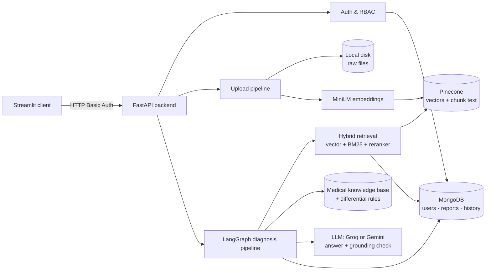

# Medical Report Diagnosis — RAG with Role-Based Access

An AI system that reads a patient's medical report (PDF or TXT) and generates a **cited, report-grounded diagnosis** using Retrieval-Augmented Generation (RAG). Patients upload reports and ask questions; doctors review their patients' diagnosis history; admins manage accounts.

> ⚠️ **Disclaimer:** This is an educational project. Its output is AI-generated information, **not medical advice**, and must be reviewed by a qualified clinician.

---

## Features

- **RAG pipeline** — reports are chunked, embedded (MiniLM) and stored in Pinecone; answers are generated only from the retrieved report text.
- **Per-report retrieval** — the vector search is filtered by document ID inside Pinecone, so a patient's question only ever retrieves their own report.
- **Page-level citations** — every answer lists its sources, e.g. `report.pdf (page 2)`.
- **Multi-file upload** — upload several PDF/TXT files at once; all are indexed under one document ID.
- **Role-based access control (RBAC)**
  - **Patient** — upload, view and delete own reports; request diagnoses; see doctor-verified results
  - **Doctor** — review (approve / edit / reject) AI answers and view history **for assigned patients only**
  - **Admin** — create accounts, assign patients to doctors, read the audit log
- **Secure signup** — public signup always creates a *patient*; doctors are created only by an admin.
- **Switchable LLM** — Groq (default `openai/gpt-oss-120b`) or Google Gemini via one `.env` setting; each answer records which model produced it.
- **Audit-friendly history** — every diagnosis is stored with question, answer, sources, model and timestamp.
- **Structured lab extraction** — lab values, units and reference ranges are parsed from the report text (e.g. `WBC Count: 11,500/uL (Reference: 4,000-11,000/uL)`).
- **Rule-based flags, not LLM guesses** — HIGH / LOW / NORMAL is computed in Python from the report's own reference range (or a built-in default range when units match); the LLM receives these flags as trusted facts.
- **Critical-value alerts** — hard-coded red-flag rules (e.g. potassium > 6.5 mmol/L) trigger an **URGENT** banner shown before any AI text.
- **Scanned reports & photos** — pages without a text layer are read with OCR (RapidOCR); PNG/JPG uploads supported.
- **My Reports** — patients can reopen any earlier upload.
- **Hybrid retrieval** — vector search (Pinecone) and keyword search (BM25) merged with Reciprocal Rank Fusion, then reordered by a cross-encoder reranker; a stuck model download never blocks a diagnosis.
- **Medical knowledge base (dual-source RAG)** — 16 curated conditions with lab patterns, summaries, confirmatory tests and MedlinePlus references, kept separate from patient facts and cited as `[KB: name]`.
- **Ranked differential diagnosis** — every condition is scored by rules from the lab pattern (supporting vs contradicting vs not-measured values) into High / Medium / Low likelihood; the LLM explains the ranking.
- **LangGraph pipeline with grounding check** — a second LLM call verifies that every patient-specific statement is supported by the report; unsupported answers are regenerated once, then flagged (or refused).
- **Doctor-in-the-loop** — every AI answer starts as a *pending review* draft; the patient's assigned doctor approves, edits or rejects it, and the patient sees a **Doctor-verified** badge. The original AI draft is kept.
- **Doctor–patient assignment** — admins assign patients to doctors; doctors can only see their own patients' records.
- **Audit log** — signups, logins, failed logins, uploads, lab views, diagnoses, history views, reviews, assignments and deletions are recorded; admins can filter the log.
- **Right to delete** — patients can permanently delete a report: vectors, raw files, the report record and its diagnosis history.
- **Privacy by design** — names, patient IDs, dates of birth, phone numbers, emails and addresses are removed **before** text is indexed or sent to an LLM (age and sex are kept).

---

## Architecture



### How it works

**1. Upload (indexing)**
```
PDF/TXT → save to disk → load pages → split into ~1000-char chunks (100 overlap)
        → MiniLM embedding (384-dim) → Pinecone upsert
          (vector + metadata: doc_id, uploader, source, page, original chunk text)
        → lab values parsed from the text, flagged HIGH/LOW by rules, critical values checked
        → report record in MongoDB (doc_id, filenames, uploader, num_chunks, labs, critical_alerts)
```

**2. Diagnosis (retrieval + generation)**
```
LangGraph:  retrieve → analyze → generate → check_grounding → finalize

retrieve         vector search (Pinecone, filter doc_id = this report) + BM25 keyword search
                 → Reciprocal Rank Fusion → cross-encoder reranker → top-5 chunks (original TEXT)
analyze          rule-checked abnormal labs → ranked differential → knowledge-base entries
generate         prompt = instructions + lab flags + differential + knowledge + report context → LLM
check_grounding  second LLM call: are all patient-specific statements supported by the report?
                 unsupported → regenerate once with feedback → still unsupported → flag (or refuse)
finalize         answer + sources + differential + knowledge sources + verdict → diagnosis history
```

The embedding model is only used for **similarity search**. The LLM receives the **original text** stored alongside each vector, never the vectors themselves.

---

## Tech Stack

| Layer | Technology |
|---|---|
| Backend API | FastAPI, Uvicorn |
| Frontend | Streamlit |
| RAG / orchestration | LangChain (text splitter, prompts), **LangGraph** (diagnosis state graph) |
| Retrieval | Pinecone vectors + BM25 (`rank-bm25`), Reciprocal Rank Fusion, cross-encoder reranker (`ms-marco-MiniLM-L-6-v2`) |
| Embeddings | `sentence-transformers` — `all-MiniLM-L6-v2` (384-dim) |
| Vector database | Pinecone (serverless) |
| LLM | Groq (`openai/gpt-oss-120b`) or Google Gemini (`gemini-2.5-flash`) |
| Database | MongoDB (users, reports, diagnosis history) |
| Auth | HTTP Basic + bcrypt password hashing, role-based access |
| PDF / OCR | pypdf (layout mode); optional RapidOCR + pypdfium2 for scanned pages and photos |
| Testing | pytest, mongomock, FastAPI TestClient |

---

## API Endpoints

| Method | Endpoint | Role | Description |
|---|---|---|---|
| `POST` | `/auth/signup` | Public | Create a **patient** account |
| `GET` | `/auth/login` | Any user | Verify credentials, return role |
| `POST` | `/auth/users` | Admin | Create a user with a role (e.g. doctor) |
| `GET` | `/auth/users` | Admin | List users (no password hashes) |
| `POST` | `/reports/upload` | Patient | Upload PDF/TXT/PNG/JPG files; returns `doc_id`, lab summary and critical alerts |
| `GET` | `/reports/mine` | Patient | List own reports, newest first |
| `GET` | `/reports/{doc_id}/labs` | Patient (own) / Doctor | Structured lab values, abnormal values and critical alerts |
| `POST` | `/diagnosis/from_report` | Patient | Ask a question about **own** report |
| `GET` | `/diagnosis/by_patient_name` | Doctor | View a patient's diagnosis history |
| `DELETE` | `/reports/{doc_id}` | Patient (own) / Admin | Permanently delete a report everywhere |
| `GET` | `/diagnosis/mine` | Patient | Own diagnosis history with review status |
| `GET` | `/diagnosis/pending` | Doctor | Review queue for assigned patients |
| `POST` | `/diagnosis/{record_id}/review` | Doctor (assigned) | Approve, edit or reject an AI answer |
| `POST` / `DELETE` | `/assignments` | Admin | Assign / unassign a patient to a doctor |
| `GET` | `/assignments` | Admin / Doctor | All assignments (admin) or own patients (doctor) |
| `GET` | `/audit` | Admin | Audit log, filterable by user and action |
| `GET` | `/health` | Public | Health check |

Interactive docs are available at `http://127.0.0.1:8000/docs` while the server is running.

---

## Project Structure

```
.
├── client/
│   └── app.py                  # Streamlit UI (patient, doctor, admin dashboards)
├── server/
│   ├── main.py                 # FastAPI app, routers, startup (admin bootstrap)
│   ├── auth/
│   │   ├── route.py            # signup, login, admin user management, RBAC
│   │   ├── models.py           # request schemas + validation
│   │   ├── assignments.py      # doctor–patient assignments
│   │   └── hash_utils.py       # bcrypt hashing
│   ├── privacy/
│   │   └── redact.py           # removes personal identifiers before indexing / LLM calls
│   ├── audit.py                # log_event(): append-only audit trail
│   ├── audit_routes.py         # admin audit-log endpoint
│   ├── config/
│   │   ├── db.py               # MongoDB collections
│   │   ├── embeddings.py       # shared embedding model (loaded once)
│   │   ├── vectordb.py         # Pinecone index (created if missing)
│   │   └── llm.py              # Groq / Gemini provider switch
│   ├── reports/
│   │   ├── route.py            # upload, my reports, lab results endpoints
│   │   ├── loaders.py          # PDF (layout + OCR fallback), TXT, image loaders
│   │   └── vectorstore.py      # load → extract labs → chunk → embed → upsert pipeline
│   ├── labs/
│   │   ├── reference.py        # default reference ranges + unit normalisation
│   │   ├── extract.py          # lab-value parser + HIGH/LOW/NORMAL flags
│   │   └── critical.py         # critical-value (red flag) rules
│   ├── diagnosis/
│   │   ├── route.py            # diagnosis + doctor history endpoints
│   │   ├── graph.py            # LangGraph pipeline + grounding check
│   │   ├── retrieval.py        # hybrid retrieval (vector + BM25 + RRF + reranker)
│   │   └── query.py            # prompt, lab-flag formatting, entry point
│   ├── knowledge/
│   │   ├── conditions.py       # curated medical knowledge base
│   │   ├── kb.py               # in-memory semantic search over the knowledge base
│   │   └── differential.py     # rule-based ranked differential diagnosis
│   └── models/
│       └── db_models.py        # Pydantic models for stored records
├── tests/                      # offline pytest suite (fakes for all external services)
├── .env.example                # all required settings (no secrets)
├── requirement.txt
├── requirements-dev.txt        # + test tools
├── requirements-ocr.txt        # + optional OCR
└── pyproject.toml
```

---

## Getting Started

### Prerequisites
- Python 3.12+
- A MongoDB database (e.g. MongoDB Atlas free tier)
- A Pinecone API key (free tier)
- A Groq API key (free tier) and/or a Gemini API key from [Google AI Studio](https://aistudio.google.com)

### 1. Clone and install
```bash
git clone https://github.com/Ja9035i/Medical_Report_Diagnosis.git
cd Medical_Report_Diagnosis
python -m venv .venv
# Windows
.venv\Scripts\activate
# macOS / Linux
source .venv/bin/activate
pip install -r requirement.txt
# Optional: OCR for scanned PDFs and photos of reports
pip install -r requirements-ocr.txt
```

### 2. Configure environment
Copy `.env.example` to `.env` and fill in your values:

| Variable | Purpose |
|---|---|
| `MONGO_URI`, `DB_NAME` | MongoDB connection |
| `PINECONE_API_KEY`, `PINECONE_INDEX_NAME`, `PINECONE_ENV` | Pinecone index (created automatically if missing) |
| `LLM_PROVIDER` | `groq` (default) or `gemini` |
| `GROQ_API_KEY`, `GROQ_MODEL` | Groq credentials / model |
| `GOOGLE_API_KEY`, `GEMINI_MODEL` | Gemini credentials / model |
| `UPLOAD_DIR` | Where uploaded files are saved |
| `RERANKER_ENABLED`, `RERANKER_TIMEOUT` | Cross-encoder reranker on/off and max wait (seconds) |
| `GROUNDING_CHECK`, `GROUNDING_MODE` | Grounding check on/off; `warn` (flag) or `refuse` unsupported answers |
| `PII_REDACTION` | Remove personal identifiers before indexing and LLM calls (default `true`) |
| `ADMIN_USERNAME`, `ADMIN_PASSWORD` | First admin account, created at startup |

Create `client/.env` with:
```
BASE_URL=http://127.0.0.1:8000
```

### 3. Run
```bash
# Terminal 1 — backend
uvicorn server.main:app --reload

# Terminal 2 — frontend
streamlit run client/app.py
```
Open **http://localhost:8501**.

### 4. Try it
1. **Patient:** sign up → log in → upload a report → *Get Diagnosis*.
2. **Admin:** log in with `ADMIN_USERNAME` / `ADMIN_PASSWORD` → create a doctor.
3. **Doctor:** log in → enter a patient's username → view their diagnosis history.

---

## Testing

### Automated tests (offline)

125 pytest tests cover auth/RBAC, doctor–patient assignments, doctor review, the audit log, report deletion, PII redaction, upload, retrieval isolation, hybrid retrieval and reranking, diagnosis, doctor history, My Reports, lab extraction and flagging, critical-value rules, OCR, the knowledge base, the differential diagnosis and every path of the LangGraph grounding loop. MongoDB, Pinecone, the embedding model and the LLM are replaced by in-memory fakes, so the suite runs in seconds, needs no API keys and never touches real data.

```bash
pip install -r requirements-dev.txt
pytest tests -q
```

### Live end-to-end check

The API was also verified end-to-end against live MongoDB, Pinecone and Groq with 16 checks, all passing:

| Area | Checks |
|---|---|
| Auth & RBAC | signup cannot claim admin/doctor; weak credentials rejected; admin bootstrap; only admin creates users |
| Upload | multi-file (PDF + TXT) indexing; unsupported file types rejected |
| Retrieval & generation | answer returned; sources from both files; page numbers on PDF sources; model recorded |
| Access control | another patient blocked from a report (403); doctor sees history; unknown patient → 404 |

---

## Roadmap

- [x] "My Reports" list so patients can return to earlier reports
- [x] Automated offline test suite (pytest)
- [x] Structured lab-value extraction with rule-based abnormal flags and critical-value alerts
- [x] OCR for scanned reports and photos
- [x] Medical knowledge base (dual-source RAG) and ranked differential diagnosis
- [x] Hybrid retrieval (vector + BM25) with cross-encoder reranking
- [x] LangGraph pipeline with grounding check
- [x] Doctor-in-the-loop review, doctor–patient assignment and audit log
- [x] Report deletion and PII redaction before indexing / LLM calls
- [ ] RAG evaluation (RAGAS) and Groq vs Gemini comparison on a test set
- [ ] JWT authentication, Docker and cloud deployment

---

## Security & Privacy Notes

- Passwords are hashed with bcrypt; secrets live only in `.env` (never committed).
- Uploaded reports are excluded from version control.
- Personal identifiers are removed before text reaches Pinecone or the LLM; the raw upload stays on the server until the patient deletes it.
- Doctors only see assigned patients; every sensitive action is written to the audit log.
- Embeddings can be partially inverted, so the vector store is treated as sensitive data.
- Use only **sample or synthetic reports** with free-tier LLM APIs.
